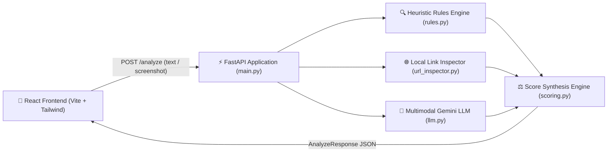

# Satark (सतर्क) — Explainable Multilingual Scam Detection Assistant

[](https://fastapi.tiangolo.com)
[](https://www.python.org/)
[](https://ai.google.dev/)
[](https://react.dev/)
[](https://vitejs.dev/)
[](https://tailwindcss.com/)
[](https://opensource.org/licenses/MIT)

> **"सतर्क रहिए, सुरक्षित रहिए"** — An explainable, privacy-first decision-support platform designed for Indian smartphone users to analyze suspicious SMS, WhatsApp, and UPI messages before acting on them.

---

## 📋 Table of Contents

- [Overview & Problem Statement](#-overview--problem-statement)
- [Key Features](#-key-features)
- [System Architecture](#-system-architecture)
- [Technology Stack](#-technology-stack)
- [Project Structure](#-project-structure)
- [Installation & Getting Started](#-installation--getting-started)
  - [Prerequisites](#prerequisites)
  - [Backend Setup (FastAPI)](#backend-setup-fastapi)
  - [Frontend Setup (React + Vite)](#frontend-setup-react--vite)
- [API Reference](#-api-reference)
  - [`GET /health`](#get-health)
  - [`POST /analyze`](#post-analyze)
- [How Scoring Works](#-how-scoring-works)
  - [Weighted Synthesis Formula](#weighted-synthesis-formula)
  - [Critical Hard Floor (40)](#critical-hard-floor-40)
  - [Genuine Transactional OTP Exemption](#genuine-transactional-otp-exemption)
  - [Verdict Bands](#verdict-bands)
- [Privacy & Security Guarantees](#-privacy--security-guarantees)
- [Known Limitations](#-known-limitations)
- [Future Roadmap](#-future-roadmap)
- [License](#-license)

---

## 🔍 Overview & Problem Statement

Digital fraud across India is surging at an unprecedented pace. Sophisticated social engineering attacks—ranging from **fake bank KYC suspensions**, **electricity bill disconnection threats**, **instant loan approval APK traps**, **lottery/KBC prize fee scams**, to **fake customer care numbers**—increasingly target first-time digital users and senior citizens.

### The Problem
- **Binary & Unhelpful:** Existing spam detection tools merely attach a generic "spam" label without explaining *why* a message is dangerous or *how* the trap operates.
- **Language Barrier:** Most cybersecurity tools cater exclusively to English, leaving Hindi and Hinglish users vulnerable.
- **Lack of Actionable Next Steps:** Victims are rarely told what immediate steps to take (e.g., dialing the **1930** cyber fraud helpline or lodging an official complaint at **cybercrime.gov.in**).
- **Privacy Concerns:** Centralized databases often store and log personal communications.

### The Satark Solution
**Satark** acts as an instant, trustworthy **second opinion**. Users simply paste a suspicious message or upload a screenshot. In seconds, Satark provides an explainable verdict, flags specific trap phrases directly within the message, inspects suspicious links, explains the scam mechanics in English and Hindi, and generates ready-to-share warnings for family members.

---

## ✨ Key Features

1. **Definitive 3-Tier Verdict & Animated Risk Gauge:**
   - Instant visual assessment: **Safe** (Emerald), **Suspicious** (Amber), or **Likely Scam** (Rose).
   - Numerical Risk Score (0–100) rendered with a smooth circular SVG meter.
2. **In-Context Phrase Highlighting:**
   - Highlights dangerous urgency phrases, credential requests, and threats directly inside the user's message using sanitized substring matching.
3. **Hybrid Detection Engine (Rules + Google Gemini):**
   - High-speed heuristic rule engine evaluating urgency, credential harvesting, impersonation, and payment pressure.
   - Multimodal Google Gemini (Gemini 2.5 Flash) for nuanced contextual reasoning and multilingual understanding.
   - Built-in resilience: If the AI API is unreachable, the system automatically falls back to deterministic rule scoring without interruption.
4. **Zero-Call Local Link Inspector:**
   - Extracts and analyzes URLs safely without making external HTTP requests.
   - Detects URL shorteners (`bit.ly`, `tinyurl.com`), suspicious top-level domains (`.xyz`, `.top`, `.click`), raw IP addresses, and brand lookalikes (spoofing SBI, HDFC, ICICI, Paytm, PhonePe, Amazon).
5. **Bilingual Localization (English & हिंदी):**
   - Instant one-click toggle across the entire application interface, explanations, and advice.
6. **Actionable Guidance & Crisis Tools:**
   - Step-by-step checklist based on the verdict.
   - One-touch dialer for the National Cyber Crime Helpline (**1930**).
   - Direct link to the official Indian reporting portal (**cybercrime.gov.in**).
   - **One-Click Family Alert:** Formatted warning text ready to forward to WhatsApp family groups.
   - **One-Click Complaint Summary:** Structured text ready to paste into official cyber police portals.
7. **8 Realistic Sample Test Chips:**
   - 4 Scams: Hinglish fake KYC, Fake loan approval with shortlink, Lottery prize fee, Electricity disconnection threat.
   - 4 Genuine: Real bank OTP alert, Courier delivery update, UPI credit notification, Food-delivery app OTP.

---

## 🏛️ System Architecture



---

## 🛠️ Technology Stack

| Layer | Technology | Purpose |
|---|---|---|
| **Backend** | Python 3.11+ / FastAPI | High-performance asynchronous REST API |
| **Validation** | Pydantic v2 | Strict request/response typing and OpenAPI auto-documentation |
| **Server** | Uvicorn | ASGI web server |
| **AI / Multimodal** | Google GenAI SDK (Gemini 2.5 Flash) | Contextual analysis, Hinglish nuance, screenshot OCR |
| **Frontend** | React 18, Vite | Mobile-first, reactive single-page interface |
| **Styling** | Tailwind CSS | Custom theme, smooth micro-animations, glassmorphism |
| **Icons** | Lucide React | Lightweight, accessible iconography |
| **Testing** | Pytest, Httpx | Automated backend validation & integration tests |

---

## 📁 Project Structure

```
satark/
├── backend/
│   ├── main.py              # FastAPI app, CORS middleware, /analyze & /health endpoints
│   ├── rules.py             # Pattern catalog, regex heuristics, genuine OTP exemption
│   ├── url_inspector.py     # Local link parser (shorteners, lookalikes, rogue TLDs)
│   ├── llm.py               # Google GenAI integration, structured prompt, fallback handler
│   ├── scoring.py           # Weighted score synthesis, hard floor logic, bilingual templates
│   ├── schemas.py           # Pydantic v2 models with complete field descriptions & examples
│   ├── requirements.txt     # Python dependencies
│   ├── .env.example         # Environment template
│   └── tests/
│       └── test_detection.py # Comprehensive pytest test suite (34 test cases)
├── frontend/
│   ├── src/
│   │   ├── components/      # UI components (RiskGauge, HighlightedMessage, InputCard, etc.)
│   │   ├── i18n.js          # Bilingual translation dictionary (English & Hindi)
│   │   ├── App.jsx          # Primary application controller
│   │   └── main.jsx         # React root entrypoint
│   ├── index.html           # HTML template
│   ├── vite.config.js       # Vite build configuration
│   ├── tailwind.config.js   # Tailwind design tokens
│   ├── package.json         # NPM dependencies & scripts
│   └── .env.example         # Frontend API URL configuration
├── .gitignore               # Multi-layer gitignore protecting keys, venvs & node_modules
├── SATARK_PROJECT.md        # Comprehensive project specification document
└── README.md                # Project documentation
```

---

## 🚀 Installation & Getting Started

### Prerequisites
- **Python 3.11+** installed (`python --version`)
- **Node.js 18+** & **npm** installed (`node --version`)
- A **Google Gemini API Key** (obtain free from [Google AI Studio](https://aistudio.google.com/))

---

### Backend Setup (FastAPI)

1. **Navigate to the backend directory:**
   ```bash
   cd backend
   ```

2. **Create and activate a virtual environment:**
   - **Windows:**
     ```powershell
     python -m venv venv
     .\venv\Scripts\activate
     ```
   - **Linux / macOS:**
     ```bash
     python3 -m venv venv
     source venv/bin/activate
     ```

3. **Install dependencies:**
   ```bash
   pip install -r requirements.txt
   ```

4. **Configure environment variables:**
   ```bash
   # Copy the sample environment file
   cp .env.example .env
   ```
   Open `backend/.env` and insert your Gemini API Key:
   ```env
   GEMINI_API_KEY=your_actual_gemini_api_key_here
   GEMINI_MODEL=gemini-2.5-flash
   HOST=0.0.0.0
   PORT=8000
   ```

5. **Run the backend server:**
   ```bash
   uvicorn main:app --reload --port 8000
   ```
   - API will be accessible at: `http://localhost:8000`
   - Interactive Swagger API Documentation: `http://localhost:8000/docs`

6. **Run tests to verify backend integrity:**
   ```bash
   python -m pytest tests/
   ```

---

### Frontend Setup (React + Vite)

1. **Navigate to the frontend directory:**
   ```bash
   cd ../frontend
   ```

2. **Install NPM dependencies:**
   ```bash
   npm install
   ```

3. **Configure environment variables:**
   ```bash
   cp .env.example .env
   ```
   Ensure `.env` points to your running backend:
   ```env
   VITE_API_URL=http://localhost:8000
   ```

4. **Start the development server:**
   ```bash
   npm run dev
   ```
   Open your browser at `http://localhost:5173` (or the URL displayed in your terminal).

---

## 📡 API Reference

Interactive OpenAPI documentation is automatically available at **`http://localhost:8000/docs`**.

### `GET /health`
Returns operational health status.

#### Request:
```bash
curl -X GET http://localhost:8000/health
```

#### Response:
```json
{
  "status": "ok"
}
```

---

### `POST /analyze`
Analyzes text, an uploaded screenshot image, or both.

- **Content-Type:** `multipart/form-data`
- **Fields:**
  - `text` *(string, optional)*: Raw SMS, WhatsApp, or UPI message text.
  - `image` *(file, optional)*: PNG or JPG screenshot (Max 5 MB).

> *Note: At least one of `text` or `image` must be provided; otherwise HTTP 422 is returned.*

#### Example Curl Request:
```bash
curl -X POST http://localhost:8000/analyze \
  -F "text=Dear SBI user, your YONO account is suspended due to pending KYC. Click http://sbi-kyc-update.xyz to verify immediately or account will be blocked today."
```

#### Example Response (`AnalyzeResponse`):
```json
{
  "verdict": "Likely Scam",
  "risk_score": 92,
  "score_breakdown": {
    "rules_score": 85,
    "llm_score": 96,
    "rules_weight": 0.4,
    "llm_weight": 0.6
  },
  "explanation_en": "This message impersonates State Bank of India (SBI) and uses artificial urgency by threatening account suspension. The provided link uses a suspicious .xyz domain designed to harvest net banking credentials.",
  "explanation_hi": "यह संदेश भारतीय स्टेट बैंक (SBI) का नाटक कर रहा है और खाता बंद होने की झूठी चेतावनी दे रहा है। दिया गया लिंक एक संदिग्ध .xyz डोमेन है जो नेट बैंकिंग विवरण चुराने के लिए बनाया गया है।",
  "red_flags": [
    "Severe urgency threat (account suspension)",
    "Requests sensitive banking verification",
    "Contains unverified link with suspicious .xyz TLD",
    "Spoofs genuine brand (SBI)"
  ],
  "scam_type": "Fake KYC / Phishing",
  "how_it_works": "Scammers clone legitimate banking login portals on lookalike domains. Once you enter your credentials or OTP on this fake page, fraudsters drain your bank account.",
  "suspicious_phrases": [
    "account is suspended",
    "pending KYC",
    "verify immediately",
    "account will be blocked"
  ],
  "links": [
    {
      "url": "http://sbi-kyc-update.xyz",
      "domain": "sbi-kyc-update.xyz",
      "is_shortener": false,
      "suspicious_tld": true,
      "lookalike_of": "SBI",
      "risk": "high"
    }
  ],
  "next_steps": [
    "Do NOT click any link in this message or share credentials.",
    "Block and report the sender on your messaging app.",
    "If money was lost, immediately report to the National Cyber Crime Helpline at 1930.",
    "Lodge an official cyber complaint at cybercrime.gov.in."
  ],
  "family_alert": {
    "en": "⚠️ ALERT: A scam message claiming SBI account suspension via http://sbi-kyc-update.xyz is circulating. Do not open the link or share OTPs. Stay alert!",
    "hi": "⚠️ सावधान: SBI खाता बंद होने का दावा करने वाला फर्जी संदेश घूम रहा है। किसी भी लिंक पर क्लिक न करें और न ही OTP साझा करें। सुरक्षित रहें!"
  },
  "report_summary": "Phishing message impersonating SBI with urgency regarding account suspension. Link: http://sbi-kyc-update.xyz.",
  "ai_available": true
}
```

---

## 🧮 How Scoring Works

Satark combines deterministic, high-speed pattern matching with semantic Large Language Model intelligence to ensure accurate, explainable scoring.

### Weighted Synthesis Formula
When Google Gemini is available (`ai_available = true`):
$$\text{Risk Score} = \text{round}(0.4 \times \text{rules\_score} + 0.6 \times \text{llm\_score})$$

If the LLM is unreachable or disabled:
$$\text{Risk Score} = \text{rules\_score}$$
*(An informational banner notifies the user that rule-based scoring was used).*

### Critical Hard Floor (40)
To prevent subtle or deceptive scams from slipping through as "Safe":
- If **credential harvesting** is detected (e.g., requests for OTP, PIN, CVV, password), OR
- If any URL in the message is classified as **High Risk** (e.g., rogue brand spoof or suspicious shortener with phishing cues),
- **The synthesized risk score is automatically elevated to at least 40**, placing it directly into the **Suspicious** category regardless of AI score.

### Genuine Transactional OTP Exemption
Legitimate bank transaction alerts frequently contain words like *"OTP"* and *"valid for 10 minutes"*. Satark includes explicit heuristic logic:
- If a message clearly contains warning phrasing like *"Do not share this OTP with anyone"* / *"Never share"*, AND
- Does **not** include external links, requests to reply, or requests to forward credentials,
- The rules engine preserves a **Safe score (0–15)** and will **not** raise false alarms.

### Verdict Bands

| Risk Score | Verdict | Visual Badge | Recommended Action |
|:---:|:---:|:---:|---|
| **0 – 34** | **Safe** | 🟢 Green | Standard caution; genuine transaction or communication. |
| **35 – 65** | **Suspicious** | 🟡 Amber | Proceed with high caution; independently verify with official contacts. |
| **66 – 100** | **Likely Scam** | 🔴 Red | High danger; block sender, do not click links, report immediately. |

---

## 🔒 Privacy & Security Guarantees

Satark was architected with a strict **privacy-by-design** philosophy:

- **Zero Data Persistence:** Satark does **not** use any database, file cache, or persistent memory store for messages. The moment your request finishes, the text and image bytes are cleared from memory.
- **No User Accounts or Tracking:** No logins, no cookies, no advertising trackers, and no telemetry tracking user identities.
- **Client-Side Secret Isolation:** The Google Gemini API key is isolated strictly within the backend `.env` environment; it is never transmitted to or visible in client-side code.
- **Input Validation & DoS Protection:** Maximum image upload size is strictly capped at **5 MB**, and only valid image MIME types (`image/png`, `image/jpeg`, `image/webp`) are accepted.
- **XSS & Injection Protection:** In-context highlighted phrases are sanitized using strict text segmentation rather than dangerous `dangerouslySetInnerHTML`.

---

## ⚠️ Known Limitations

1. **Decision-Support Only:** Satark is a decision-support advisory tool, **not** an infallible security guarantee. Users should always contact their bank via the phone number printed on the back of their physical card when in doubt.
2. **No Measured Benchmark Dataset:** While validated against standard scam patterns, formal precision/recall metrics have not yet been evaluated across massive national datasets.
3. **Image Quality & OCR:** Blurry, low-resolution, or stylized fonts in screenshots may lead to misread characters.
4. **LLM Non-Determinism:** Contextual interpretations from Large Language Models may show minor variations across runs for borderline messages.

---

## 🗺️ Future Roadmap

- [ ] **Labeled Evaluation Benchmark:** Curate a gold-standard dataset of 1,000+ Indian fraud messages to measure precision, recall, and false positive rates.
- [ ] **Voice Note & Call Audio Transcription:** Integrate speech-to-text to analyze fraudulent phone calls and WhatsApp audio notes.
- [ ] **Instant Messaging Bots:** Deploy Satark as a lightweight WhatsApp and Telegram bot for seamless forwarding.
- [ ] **Browser Extension:** Inline detection for web-based WhatsApp, Telegram Web, and webmail clients.
- [ ] **Crowdsourced Scam Intelligence:** Anonymized, hash-based community reporting feed to track emerging fraud campaigns in real-time.
- [ ] **Expanded Regional Languages:** Add support for Tamil (தமிழ்), Telugu (తెలుగు), Bengali (বাংলা), Marathi (मराठी), and Kannada (ಕನ್ನಡ).

---

## 📄 License

Distributed under the **MIT License**. See `LICENSE` for more information.

---

<div align="center">
  <sub>Built with care to protect Indian citizens from digital fraud.</sub>
</div>
