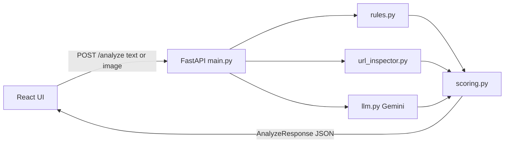

# Satark: Explainable Multilingual Scam Detection Assistant

> **Instruction to the AI coding agent:** Read this entire document, then build the project exactly as specified. Build it in the order given in "Build Order". Prioritize a working, polished, demo-ready MVP over extra features. Do not add a database, user accounts, or any storage of user messages.

---

## 1. Overview

**Satark** (Hindi for "alert") is a mobile-friendly web app that helps Indian users check suspicious SMS, WhatsApp, and UPI messages before acting on them.

A user pastes a message or uploads a screenshot. Satark returns:

- A clear verdict: **Safe / Suspicious / Likely Scam**
- A 0-100 risk score with a breakdown of rules vs AI contribution
- The user's own message with the **suspicious phrases highlighted**
- Red flags and a "How this scam works" explanation
- A **link inspector** (shorteners, suspicious TLDs, lookalike brand domains)
- Explanations in **English and Hindi**
- Next steps (block, report at cybercrime.gov.in, call the 1930 helpline)
- A ready-to-forward **family alert** and a copyable **cybercrime report summary**

### Problem
Digital fraud in India (fake KYC, fake loan apps, OTP theft, lottery/prize scams, fake customer care) hits first-time digital users and seniors hardest. Existing tools mostly return a bare "spam" label, work best in English, and don't tell users what to do next.

### Target users
Everyday Indian smartphone users, especially those more comfortable in Hindi/Hinglish, and family members who help seniors stay safe.

### Positioning
A **decision-support** tool giving a trustworthy, understandable second opinion. It is not a guarantee of safety.

---

## 2. Tech Stack

| Layer | Choice |
|---|---|
| Backend | Python 3.11+, FastAPI, Uvicorn, Pydantic v2 |
| AI | Google Gemini (latest Flash model available in Google AI Studio), multimodal (text + image), JSON output. Model name configurable via `GEMINI_MODEL` env var |
| Frontend | React (Vite) + Tailwind CSS, mobile-first |
| Config | `.env` file (`GEMINI_API_KEY`, `GEMINI_MODEL`), loaded with `python-dotenv` |
| Storage | **None.** Stateless. No database. Messages are never stored or logged |
| Docs | FastAPI auto-docs at `/docs`, plus `README.md` |

---

## 3. Architecture



### Project structure

```
satark/
├── backend/
│   ├── main.py            # FastAPI app, CORS, /analyze, /health
│   ├── rules.py           # rule-based detector
│   ├── url_inspector.py   # link analysis (no external network calls)
│   ├── llm.py             # Gemini call + prompt + JSON parsing
│   ├── scoring.py         # combine scores, verdict, next steps
│   ├── schemas.py         # Pydantic models with field descriptions + examples
│   ├── requirements.txt
│   └── .env.example
├── frontend/              # React + Vite + Tailwind
│   └── src/ (App, components, i18n strings, sample messages)
└── README.md
```

---

## 4. API Specification

### `POST /analyze`
Content type: `multipart/form-data`

| Field | Type | Notes |
|---|---|---|
| `text` | string, optional | The suspicious message |
| `image` | file, optional | PNG/JPG screenshot (limit 5 MB) |

At least one of `text` or `image` is required, otherwise return HTTP 422 with a clear message. If both are given, analyze both (image text is appended to text).

### `GET /health`
Returns `{"status": "ok"}`.

### Response schema (`AnalyzeResponse`)

```json
{
  "verdict": "Likely Scam",
  "risk_score": 87,
  "score_breakdown": { "rules": 80, "ai": 92 },
  "scam_type": "Fake KYC",
  "how_it_works": "Scammers pose as your bank and threaten account closure to make you share your OTP or click a fake link.",
  "extracted_text": "Dear customer, your SBI account will be blocked today. Update KYC: http://sbi-kyc-update.xyz",
  "suspicious_phrases": ["account will be blocked", "Update KYC"],
  "red_flags": ["Creates urgency", "Asks for personal details", "Suspicious link"],
  "links": [
    {
      "url": "http://sbi-kyc-update.xyz",
      "domain": "sbi-kyc-update.xyz",
      "is_shortener": false,
      "suspicious_tld": true,
      "lookalike_of": "SBI",
      "risk": "high"
    }
  ],
  "explanation_en": "This message pretends to be from SBI and pressures you to act urgently...",
  "explanation_hi": "यह संदेश SBI होने का दिखावा करता है और आप पर जल्दबाज़ी का दबाव डालता है...",
  "next_steps": [
    "Do not click the link",
    "Block the sender",
    "Report at cybercrime.gov.in or call 1930"
  ],
  "family_alert": { "en": "...", "hi": "..." },
  "report_summary": "...",
  "ai_available": true
}
```

All fields must have descriptions and the model must include an example so `/docs` is fully documented.

---

## 5. Component Specifications

### 5.1 `rules.py`
Returns `rules_score` (0-100) and a list of matched flags. Case-insensitive. Check for:

- **Urgency:** "within 24 hours", "immediately", "blocked", "suspended", "last warning", "expires today", and Hinglish equivalents ("turant", "abhi", "band ho jayega")
- **Credential requests:** OTP, PIN, CVV, password, card number, Aadhaar/PAN sharing requests
- **Scam themes:** fake KYC update, lottery/prize/lucky draw, loan approved/pre-approved, refund/cashback, electricity bill disconnection, fake customer care, job offer with a fee
- **Impersonation:** bank names (SBI, HDFC, ICICI, Axis, PNB), Paytm, PhonePe, Google Pay, Amazon, Flipkart, TRAI, RBI, Income Tax, courier firms
- **Payment pressure:** requests to send money, "pay a small fee to release", UPI collect requests
- **Link presence** (combined with the other signals)

Each category adds weighted points; cap at 100. Return flags as short human-readable strings.

**Important exception:** a message that merely *delivers* a genuine OTP or transaction alert ("123456 is your OTP. Do not share it with anyone.") should NOT score high. Only a request to *share* an OTP/PIN or click a link is a red flag. Include a dedicated check: if the text contains "do not share" / "never share" language and no link or request to share, reduce the credential-request score.

### 5.2 `url_inspector.py`
No external network calls. For each URL found (regex) use `urllib.parse`:

- `is_shortener`: known shorteners (bit.ly, tinyurl.com, t.co, goo.gl, cutt.ly, rb.gy, is.gd, shorturl.at, etc.)
- `suspicious_tld`: .xyz, .top, .click, .live, .site, .online, .icu, .buzz, .cfd, etc.
- `lookalike_of`: small dict of brand keywords mapped to official domains (sbi to sbi.co.in/onlinesbi.sbi, hdfc to hdfcbank.com, icici to icicibank.com, axis to axisbank.com, paytm to paytm.com, phonepe to phonepe.com, amazon to amazon.in/amazon.com, etc.). Flag when the brand keyword appears in the domain but the domain is not official.
- Also flag raw IP-address hosts, excessive hyphens or subdomains, and `http://` (non-HTTPS).
- `risk`: low / medium / high based on the combination.

### 5.3 `llm.py`
Calls Gemini via the Google AI Studio API with image input supported and JSON output enforced.

**System prompt (use verbatim as the base):**

> You are a fraud analyst helping everyday Indian smartphone users. You understand English, Hindi (Devanagari), and Hinglish (Hindi in Roman script). Analyze the given message (or screenshot) for scam risk.
>
> Rules:
> - Receiving a genuine OTP, bank transaction alert, or delivery update is NORMAL. The red flag is being ASKED to share an OTP/PIN/CVV/password, to click an unfamiliar link, to install an app, or to send money.
> - Be calibrated. Do not label ordinary messages as scams. Do not call a clear scam safe.
> - `suspicious_phrases` must be EXACT substrings copied character for character from `extracted_text`.
> - If the input is an image, read all the text in it into `extracted_text`.
> - Write explanations in simple language a first-time smartphone user can understand. Provide both English and natural Hindi.
> - Return ONLY valid JSON, no markdown, matching this structure:
> `{"llm_score": 0-100, "scam_type": string, "how_it_works": string, "extracted_text": string, "suspicious_phrases": [string], "red_flags": [string], "explanation_en": string, "explanation_hi": string, "family_alert": {"en": string, "hi": string}, "report_summary": string}`
> - `scam_type` examples: "Fake KYC", "Fake Loan", "Lottery / Prize", "OTP Theft", "Fake Customer Care", "Phishing Link", "Job Offer Scam", "Not a scam".
> - `family_alert`: a short, friendly, forwardable warning about this kind of scam (2-3 sentences).
> - `report_summary`: a factual 3-4 line summary suitable for pasting into a cybercrime complaint (what was received, what it asked for, any links).

Handle malformed JSON by stripping code fences and retrying once. On any failure, return `None` so the app falls back to rules-only.

### 5.4 `scoring.py`
- `risk_score = round(0.4 * rules_score + 0.6 * llm_score)`
- **Hard floor:** if the message asks the user to share an OTP/PIN/CVV/password, or a link has `risk == "high"`, the risk score must be at least 40.
- **Verdict bands:** below 35 = **Safe**, 35-65 = **Suspicious**, above 65 = **Likely Scam**
- If the LLM is unavailable: use `rules_score` alone, set `ai_available = false`, and the UI shows a notice "AI analysis unavailable, showing rule-based result only".
- Merge `red_flags` from rules, links, and LLM, deduplicated, max 6.
- `next_steps` for Suspicious and Likely Scam must always include: do not click links or share OTP/PIN, block the sender, and "Report at cybercrime.gov.in or call 1930". For Safe, give brief caution ("No major red flags found, but stay careful").
- If the LLM call failed, generate a basic explanation, family alert, and report summary from templates so the UI never shows empty sections.

---

## 6. Frontend Specification

Mobile-first, clean, trustworthy look (calm blue/white base; green, amber, red for verdicts). Bilingual with a toggle: **EN / हिं** (all UI labels, explanations, and next steps switch).

### Layout
1. **Header:** Satark logo/wordmark, language toggle, one-line privacy note: "Your message is analyzed and never stored."
2. **Input card:**
   - Textarea with placeholder ("Paste the suspicious message here...")
   - Screenshot drop-zone with preview and remove button
   - **Analyze** button (disabled when empty), with a loading skeleton during analysis
   - **8 sample chips** (clicking fills the textarea):
     - Scams: Hinglish fake KYC, fake loan approval with a short link, lottery prize with a fee, fake electricity bill disconnection threat
     - Genuine: real bank OTP alert, delivery update, UPI credit alert, OTP from a food-delivery app
3. **Result card** (animated reveal after analysis):
   - Colored **verdict banner** (green/amber/red) with an **animated circular risk gauge** and score
   - **Message view:** the extracted/original message with `suspicious_phrases` highlighted (case-insensitive; if no phrase matches, silently skip highlighting)
   - **Score breakdown:** a stacked or dual bar showing Rules vs AI contribution, labeled "How we got this score"
   - **Scam type badge** and a **"How this scam works"** box
   - **Red flag chips**
   - **Link inspector table** (domain, shortener, suspicious TLD, lookalike brand, risk badge). Hidden if no links
   - **Explanation** (EN/HI per toggle)
   - **Next steps** checklist, with a link to cybercrime.gov.in and the 1930 helpline
   - Buttons: **Copy family alert** and **Copy report summary** (show a "Copied" toast)
4. **Footer:** disclaimer ("Satark is a decision-support tool, not a guarantee. When in doubt, contact your bank using the number on your card."), link to `/docs`, and a "Try another message" button.

### UX requirements
- Works well at 360px width and on desktop
- Clear error states (network error, invalid file, empty input)
- Accessible contrast, large tap targets
- No data persisted in the browser
- The frontend reads the backend URL from `VITE_API_URL`

---

## 7. Privacy and Safety Requirements

- Do not store, log, or persist user messages or images, in memory beyond the request, files, or databases
- No user accounts or tracking
- Keep the API key in `.env` only; never expose it in frontend code
- Limit image upload size (5 MB) and accept only image MIME types
- Sanitize any text rendered in the UI (prevent HTML/script injection when highlighting phrases)
- Show the decision-support disclaimer in the UI

---

## 8. Build Order

1. Scaffold the backend and `schemas.py` with the full response model and examples
2. Implement `rules.py` and `url_inspector.py`, with quick tests on the sample messages
3. Implement `llm.py` and `scoring.py`, and wire up `/analyze` with the rules-only fallback
4. Scaffold the frontend with Tailwind, the input card, and sample chips
5. Build the result card (verdict banner, gauge, highlighted message, breakdown, flags, link table, next steps, copy buttons)
6. Add the EN/Hindi toggle
7. Test all 8 sample messages and one screenshot, and fix wrong verdicts. Verify a genuine OTP alert is NOT flagged as a scam
8. Write the README, then do final UI polish

---

## 9. Acceptance Criteria

- [ ] The 4 scam samples produce **Suspicious** or **Likely Scam**; the 4 genuine samples produce **Safe**
- [ ] A genuine OTP alert ("Do not share this OTP with anyone") is Safe
- [ ] Highlighted phrases appear inside the message; no crash if none match
- [ ] Screenshot upload extracts text and returns a full result
- [ ] Hindi toggle switches the UI and explanations
- [ ] Both copy buttons work
- [ ] If the Gemini call fails, the app still returns a rules-only result with a visible notice
- [ ] `/docs` shows documented request and response schemas with examples
- [ ] No message data is stored anywhere
- [ ] Looks good at 360px width

---

## 10. README Requirements

The generated `README.md` should include:

1. Project overview and problem statement
2. Key features
3. Architecture diagram (Mermaid, as above)
4. Tech stack
5. Setup and run instructions (backend: venv, `pip install -r requirements.txt`, copy `.env.example` to `.env`, `uvicorn main:app --reload`; frontend: `npm install`, `npm run dev`)
6. API reference with an example request and response
7. How scoring works (rules + AI blend, hard floor, verdict bands)
8. Privacy and security notes
9. Limitations (not a guarantee; no benchmark evaluation yet; screenshots may be misread when blurry; LLM output can be inconsistent)
10. Roadmap: labeled evaluation dataset with precision/recall, voice-note and call-transcript analysis, WhatsApp/Telegram bot, browser extension, community scam-pattern reporting feed, more regional languages

---

## 11. Out of Scope for This MVP

User accounts, databases, live call interception, native mobile app, browser extension, payment features, and any claim of measured accuracy (no labeled dataset exists yet).
